# turkce-rag

[](https://github.com/K4gan/turkce-rag/actions/workflows/ci.yml)
[](LICENSE)


**Türkçe öncelikli, kaynak gösteren hibrit RAG motoru.** PDF, Markdown/TXT ve web sayfalarını
indeksler; soruları Türkçe yanıtlar ve her iddiayı belge + sayfa/bölüm atfıyla destekler.
Kaynaklarda yanıt yoksa uydurmak yerine "bulamadım" der.

> **English summary.** `turkce-rag` is a Turkish-first retrieval-augmented generation engine
> (Python library + CLI + FastAPI). It ingests PDFs, Markdown/TXT and web pages, chunks them with
> Turkish-aware sentence splitting, retrieves with BM25 (Turkish casing, light suffix stripping,
> diacritic folding) fused with multilingual-e5 dense embeddings via Reciprocal Rank Fusion, and
> answers with inline `[n]` citations pointing to document + page/section. Low retrieval
> confidence → it says it doesn't know. LLM backends: OpenAI-compatible APIs, Ollama, or a
> deterministic offline stub used in tests/CI. Measured numbers are in the
> [evaluation](#değerlendirme) section.

```console
$ turkce-rag ingest data/sample
✓ 40 parça eklendi · indekste toplam 40 parça, 11 belge → .turkce-rag

$ turkce-rag ask "Kapadokya yeraltı şehirlerinin girişleri nasıl korunurdu?"
Girişler, içeriden yuvarlanarak kapatılan büyük taş kapılarla korunurdu. [1] Tüfün kolay
oyulabilmesi, insanların bu kayaya yalnızca evler değil, çok katlı yeraltı şehirleri de
kazmasını sağladı. [1]

Kaynaklar:
  [1] Kapadokya › Yeraltı şehirleri  (data/sample/kapadokya.md)

$ turkce-rag ask "Ankara'nın nüfusu kaçtır?"
Bu soruya verilen kaynaklarda bir yanıt bulamadım.
```

*(Yukarıdaki çıktı varsayılan, çevrimdışı `stub` LLM ile üretildi; o yüzden yanıt kaynaktan
alıntıdır. `--llm openai` ya da `--llm ollama` ile üretken yanıt alınır.)*

## Neden Türkçe'ye özel işlem gerekiyor?

Hazır RAG şablonları çoğunlukla İngilizce varsayımlarıyla gelir ve Türkçe'de sessizce bozulur:

| Sorun | Örnek | turkce-rag ne yapıyor |
|---|---|---|
| **Büyük/küçük harf** | Python'da `"I".lower()` → `i` (doğrusu `ı`), `"İ".lower()` → `i̇` (i + birleşik nokta, U+0307) | `turkish_lower` / `turkish_upper`, NFC normalizasyonu |
| **Eklemeli yapı** | `kitap`, `kitabı`, `kitaplarımızdan` BM25 için üç farklı terim | Hafif ek soyucu + ünsüz yumuşaması geri alma (`kitab` → `kitap`) |
| **Özel ad + kesme** | `İstanbul'da`, `KVKK'ya` | Kesme işaretinden sonrası atılır |
| **ASCII klavye** | `"enkaz altinda kalan biri ne yapmali"` | İsteğe bağlı aksan katlama (`ş→s`, `ı→i`), şapka (`â, î`) yok sayılır |
| **Cümle sınırları** | `Prof. Dr.`, `vb.`, `T.C.`, `19. yüzyıl`, `1. Dünya Savaşı` | Kısaltma listesi + Türkçe sıra sayısı kuralı |
| **PDF kirliliği** | `bilgi-\nsayar`, `fi` ligatürü, yumuşak tire, `’` | `normalize_text` bunları temizler |

Kök bulucu bilinçli olarak *hafif*tir: dilbilimsel olarak doğru kök değil, aynı sözcüğün çekimli
biçimlerini **tutarlı** biçimde aynı anahtara indirmeyi hedefler. Fiil çekimlerine ve yapım
eklerine dokunmaz (`yeraltı` ↛ `yeral`). Tam morfolojik çözümleme (Zemberek vb.) yol haritasında.

## Mimari

```mermaid
flowchart LR
    subgraph Ingest["Yükleme (ingest)"]
        A[PDF · MD/TXT · URL] --> B[Yükleyiciler<br/>sayfa / bölüm bilgisiyle]
        B --> C[normalize_text<br/>NFC · tireleme · ligatür]
        C --> D[Türkçe cümle bölücü<br/>kısaltma · sıra sayısı]
        D --> E[Parçalar<br/>≤700 krk · 1 cümle örtüşme<br/>sayfa/bölüm sınırını aşmaz]
    end
    E --> F[(BM25<br/>Türkçe analizör)]
    E --> G[(Yoğun vektörler<br/>multilingual-e5-small)]
    subgraph Query["Sorgu"]
        Q[Soru] --> F & G
        F --> R[RRF füzyonu]
        G --> R
        R --> RR[İsteğe bağlı reranker]
        RR --> T{Güven eşiği<br/>IDF ağırlıklı kapsama}
        T -- düşük --> N["“Bulamadım”"]
        T -- yeterli --> L[LLM<br/>stub · OpenAI uyumlu · Ollama]
        L --> P[Atıf ayrıştırma<br/>&#91;n&#93; → belge + sayfa/bölüm]
    end
```



**Temel tasarım kararları**

- **Hibrit arama + RRF.** BM25 nadir terimlerde (ör. `RuBisCO`, `VERBİS`, sayılar) güçlüdür;
  yoğun model eşanlamlı ve farklı ifade edilmiş sorularda. Skorlar farklı ölçeklerde olduğu için
  toplanmaz; [Reciprocal Rank Fusion](https://plg.uwaterloo.ca/~gvcormac/cormacksigir09-rrf.pdf)
  yalnızca sıraları kullanır, kalibrasyon gerektirmez.
- **Bağlamlı parça.** Parçalar başlık ve bölüm yoluyla birlikte indekslenir
  (`KVKK Özeti › Veri ihlali ve VERBİS`), böylece "en geç 72 saat içinde" gibi bağlamsız cümleler
  de doğru soruya eşleşir. Atıf için parçanın kendisi sayfa/bölüm bilgisini taşır.
- **"Bilmiyorum" LLM'den önce.** Sorgu köklerinin IDF ağırlıklı kapsaması en iyi parçalarda
  `min_coverage` (vars. 0.5) altındaysa LLM hiç çağrılmaz. Derlemde hiç geçmeyen ayırt edici bir
  terim ("espresso") en yüksek ağırlığı alır; "hazırlanır" gibi genel bir terimin eşleşmesi tek
  başına güven üretmez. Hafif kök bulucunun kaçırdığı fiil çekimleri için önek toleransı vardır.
- **Her şey değiştirilebilir, hiçbir şey zorunlu değil.** `Embedder`, `LLM`, `Reranker` birer
  `Protocol`; yoğun arama (`[dense]`) ve API (`[api]`) isteğe bağlı bağımlılıklar. Çekirdek
  yalnızca `numpy`, `pypdf`, `httpx`, `beautifulsoup4` ister.
- **Test edilebilirlik.** `StubLLM` (deterministik, çıkarımsal) ve `HashingEmbedder`
  (karakter n-gram hashing) sayesinde test paketi ve CI ağ, API anahtarı ya da model indirmesi
  olmadan uçtan uca çalışır.

## Kurulum

```bash
git clone https://github.com/K4gan/turkce-rag && cd turkce-rag
python -m venv .venv && source .venv/bin/activate

# Yalnızca CPU kullanacaksanız önce hafif PyTorch (isteğe bağlı ama önerilir):
pip install --index-url https://download.pytorch.org/whl/cpu torch

pip install -e ".[dense,api]"      # yoğun arama + HTTP API
# pip install -e .                 # yalnızca BM25 (model indirmesi yok)
```

İlk yoğun indekslemede `intfloat/multilingual-e5-small` (~470 MB) Hugging Face'ten indirilir.

## Hızlı başlangıç

### CLI

```bash
# Dosya, klasör (özyinelemeli) ya da URL indeksle
turkce-rag ingest data/sample
turkce-rag ingest rapor.pdf https://tr.wikipedia.org/wiki/Fotosentez

# Soru sor (varsayılan: hibrit arama + stub LLM)
turkce-rag ask "Veri ihlali kaç saat içinde bildirilmeli?"
turkce-rag ask "izin talebi kac gun once yapilir" --json        # ASCII yazım da çalışır

# Gerçek LLM ile
export OPENAI_API_KEY=...                                      # anahtar yalnızca ortamdan okunur
turkce-rag ask "Peribacaları nasıl oluşur?" --llm openai:gpt-4o-mini
OLLAMA_HOST=http://localhost:11434 turkce-rag ask "..." --llm ollama:qwen2.5:7b

# Yalnızca arama, mod karşılaştırması
turkce-rag search "RuBisCO" --mode bm25
turkce-rag search "bitkiler neden yeşil" --mode dense

# Model indirmeden: yalnızca BM25 ya da hashing embedder
turkce-rag ingest data/sample --index .idx-bm25 --embedder none
```

`ask`, yanıt bulamadığında **2** çıkış kodu döner (betiklerde kullanışlı).

| Ortam değişkeni | Açıklama | Varsayılan |
|---|---|---|
| `TURKCE_RAG_INDEX` | İndeks klasörü | `.turkce-rag` |
| `TURKCE_RAG_EMBEDDER` | `e5` · `hash` · `none` · HF model adı | `e5` |
| `TURKCE_RAG_LLM` | `stub` · `openai[:model]` · `ollama[:model]` | `stub` |
| `OPENAI_API_KEY`, `OPENAI_BASE_URL` | OpenAI uyumlu uç nokta (vLLM, LM Studio, OpenRouter …) | `https://api.openai.com/v1` |
| `TURKCE_RAG_MODEL` | OpenAI uyumlu model adı | `gpt-4o-mini` |
| `OLLAMA_HOST`, `TURKCE_RAG_OLLAMA_MODEL` | Ollama sunucusu ve modeli | `http://localhost:11434`, `qwen2.5:7b` |

### HTTP API

```bash
turkce-rag serve --port 8000          # yalnızca 127.0.0.1'e bağlanır
```

```bash
curl -s localhost:8000/ask -H 'content-type: application/json' \
  -d '{"question": "Yıllık eğitim bütçesi ne kadar?", "top_k": 4}'
```

```json
{
  "question": "Yıllık eğitim bütçesi ne kadar?",
  "answer": "Her çalışan için yıllık 12.000 TL tutarında kişisel eğitim bütçesi ayrılır. [1] Konferansta konuşmacı olarak kabul edilen çalışanların yol ve konaklama giderleri eğitim bütçesinden düşülmez, şirket tarafından ayrıca karşılanır. [1]",
  "confident": true,
  "sources": [
    {
      "n": 1,
      "doc_id": "mavi-liman-el-kitabi",
      "title": "Mavi Liman Yazılım Çalışan El Kitabı",
      "source": "data/sample/mavi_liman_el_kitabi.pdf",
      "location": "Mavi Liman Yazılım Çalışan El Kitabı, s. 3",
      "page": 3,
      "section": null,
      "snippet": "Eğitim ve Gelişim\n\nHer çalışan için yıllık 12.000 TL tutarında kişisel eğitim bütçesi ayrılır. ..."
    }
  ]
}
```

Uç noktalar: `GET /health`, `POST /search`, `POST /ask`, `POST /ingest` (`{"urls": [...]}`;
güvenlik için yerel dosya yolu kabul etmez). Etkileşimli belgeler: `http://localhost:8000/docs`.

### Docker

```bash
docker build -t turkce-rag .
docker run --rm -v rag-data:/data turkce-rag ingest /app/data/sample
docker run --rm -p 8000:8000 -v rag-data:/data turkce-rag
```

İmaj CPU PyTorch kullanır ve gömme modelini derleme sırasında indirir; konteyner çalışırken
internete çıkmaz (URL indekslemediğiniz sürece).

### Kütüphane olarak

```python
from turkce_rag import RAGEngine
from turkce_rag.embeddings import SentenceTransformerEmbedder
from turkce_rag.llm import OllamaLLM

engine = RAGEngine(embedder=SentenceTransformerEmbedder(), llm=OllamaLLM("qwen2.5:7b"))
engine.ingest(["belgeler/", "https://ornek.com/yazi"])
engine.save(".turkce-rag")

answer = engine.ask("Kişisel verilerin silinmesini nasıl isteyebilirim?")
print(answer.text)
for s in answer.sources:
    print(s.n, s.location)
```

## Değerlendirme

`eval/qa.jsonl`: örnek derlem üzerinde **30 cevaplanabilir + 5 cevaplanamaz** Türkçe soru. Sorular
belgedeki ifadeyi kopyalamaz; farklı çekimler, eş anlamlılar ve 2 tanesi Türkçe karaktersiz
(ASCII) yazılmıştır. Bir parça, doğru belgeye aitse ve altın kanıt metnini içeriyorsa "ilgili"
sayılır. "ASCII sorgu" sütunu aynı 30 sorunun tamamının `ş→s, ı→i …` katlanmış hâlidir.

```bash
python eval/run_eval.py            # e5 modeliyle (CPU'da ~10 sn)
python eval/run_eval.py --no-e5    # model indirmeden
```

**Ölçülen sonuçlar** (11 belge, 40 parça, CPU, Python 3.13; ham çıktı: [`eval/results.json`](eval/results.json)):

| Yöntem | Recall@1 | Recall@3 | Recall@5 | MRR@10 | MRR@10 (ASCII sorgu) |
|---|---:|---:|---:|---:|---:|
| BM25 (düz tokenizasyon) | 0.800 | 0.967 | 1.000 | 0.886 | 0.687 |
| BM25 (Türkçe analizör) | 0.900 | 1.000 | 1.000 | 0.950 | 0.950 |
| Dense (multilingual-e5-small) | 0.933 | 1.000 | 1.000 | 0.967 | 0.864 |
| **Hibrit RRF (BM25-TR + e5-small)** | **0.967** | 1.000 | 1.000 | **0.983** | 0.942 |
| Dense (hashing, model yok) | 0.867 | 1.000 | 1.000 | 0.933 | 0.933 |
| Hibrit RRF (BM25-TR + hashing) | 0.933 | 1.000 | 1.000 | 0.967 | 0.967 |

**"Bilmiyorum" eşiği** (hibrit + e5, `min_coverage` taraması):

| `min_coverage` | Cevaplanabilir → yanıtlandı | Cevaplanamaz → "bulamadım" |
|---:|---:|---:|
| 0.3 | 30/30 | 2/5 |
| 0.4 | 29/30 | 4/5 |
| **0.5 (varsayılan)** | **28/30** | **5/5** |
| 0.6 | 23/30 | 5/5 |
| 0.7 | 19/30 | 5/5 |

Varsayılan eşikle yanıtlanan 28 sorunun 28'inde doğru belgeye atıf yapıldı.

**Okuma notları — dürüst sınırlar**

- Türkçe analizör, düz BM25'e göre Recall@1'i 0.800 → 0.900, MRR'ı 0.886 → 0.950'ye çıkarıyor.
  Asıl fark ASCII sorgularda: düz BM25 0.687'ye, e5 0.864'e düşerken Türkçe analizör 0.950'de
  sabit kalıyor. Hibrit, normal sorgularda en iyi Recall@1/MRR'ı veriyor.
- Derlem küçük (40 parça); Recall@3 ve @5 neredeyse tüm yöntemlerde doymuş durumda. Farklar
  esas olarak 1. sıradadır ve 30 soruluk bir sette bir soru = 0.033 puandır; bu tabloyu
  istatistiksel bir kıyaslama değil, bir duman testi ve gerileme (regression) kontrolü olarak
  okuyun.
- `min_coverage` aynı set üzerinde seçildi (örneklem içi). Gerçek derlemlerde kendi soru setinizle
  yeniden ayarlayın; `eval/run_eval.py --qa sizin.jsonl --corpus belgeler/`.
- Cevaplama satırları `stub` LLM ile ölçüldü: yalnızca güven eşiği ve atıf zincirini ölçer,
  üretken yanıt kalitesini değil.

## Proje yapısı

```
src/turkce_rag/
  normalize.py    Türkçe büyük/küçük harf, aksan katlama, PDF temizliği
  analysis.py     tokenizasyon, durak sözcükler, hafif kök bulucu, kapsama skoru
  chunking.py     Türkçe cümle bölücü ve parçalama
  loaders.py      PDF (sayfa), Markdown (bölüm), TXT, URL (HTML → bölüm)
  bm25.py         Okapi BM25
  embeddings.py   multilingual-e5 sarmalayıcısı + HashingEmbedder
  fusion.py       Reciprocal Rank Fusion
  index.py        kalıcı indeks (JSONL + .npy)
  retriever.py    bm25 / dense / hybrid arama, reranker kancası
  llm.py          stub · OpenAI uyumlu · Ollama, atıf ayrıştırma
  pipeline.py     RAGEngine: ingest → search → ask
  cli.py, api.py  komut satırı ve FastAPI
data/sample/      özgün Türkçe örnek derlem (kurgusal şirket el kitabı PDF'i dahil)
eval/             soru seti ve değerlendirme betiği
```

## Geliştirme

```bash
pip install -e ".[dev]"
ruff check . && ruff format --check . && mypy src
pytest                       # ağ/model gerektirmez
RUN_SLOW=1 pytest            # gerçek e5 modeliyle duman testi
python scripts/make_sample_pdf.py   # örnek PDF'i yeniden üret (reportlab)
```

## Yol haritası

- [ ] Zemberek / TRMorph tabanlı isteğe bağlı morfolojik çözümleyici (fiil çekimleri, ünlü düşmesi: `izin` ↔ `izni`)
- [ ] Daha büyük, gerçek dünya Türkçe değerlendirme seti (ör. TQuAD tabanlı) ve LLM yanıt kalitesi ölçümü
- [ ] Varsayılan çok dilli cross-encoder reranker ve etkisinin ölçülmesi
- [ ] Akışlı (streaming) yanıtlar ve `/ask` için SSE
- [ ] Büyük derlemler için ANN (FAISS / hnswlib) ve artımlı BM25
- [ ] Taranmış PDF'ler için OCR (Tesseract `tur`)
- [ ] DOCX ve HTML dosya yükleyicileri

## Örnek derlem hakkında

`data/sample/` altındaki tüm metinler bu proje için özgün olarak yazılmıştır ve projeyle aynı
MIT lisansı altındadır. `mavi_liman_el_kitabi.pdf` kurgusal bir şirkete aittir. KVKK ve İş Kanunu
özetleri genel bilgilendirme amaçlıdır, hukuki tavsiye değildir.

## Lisans

[MIT](LICENSE)
